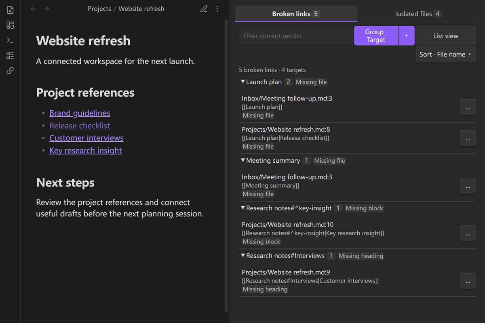
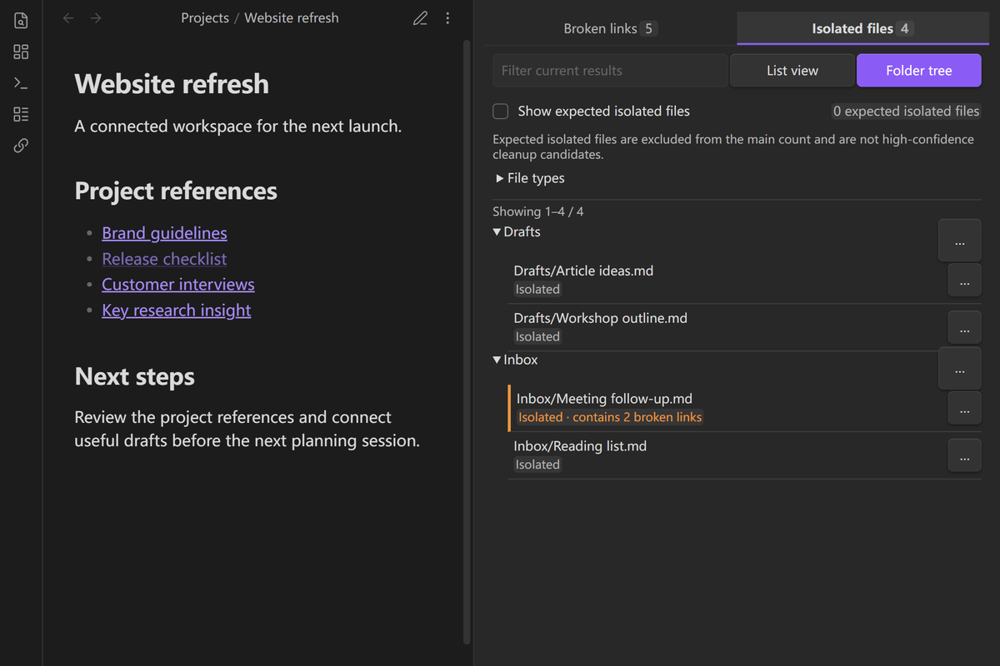
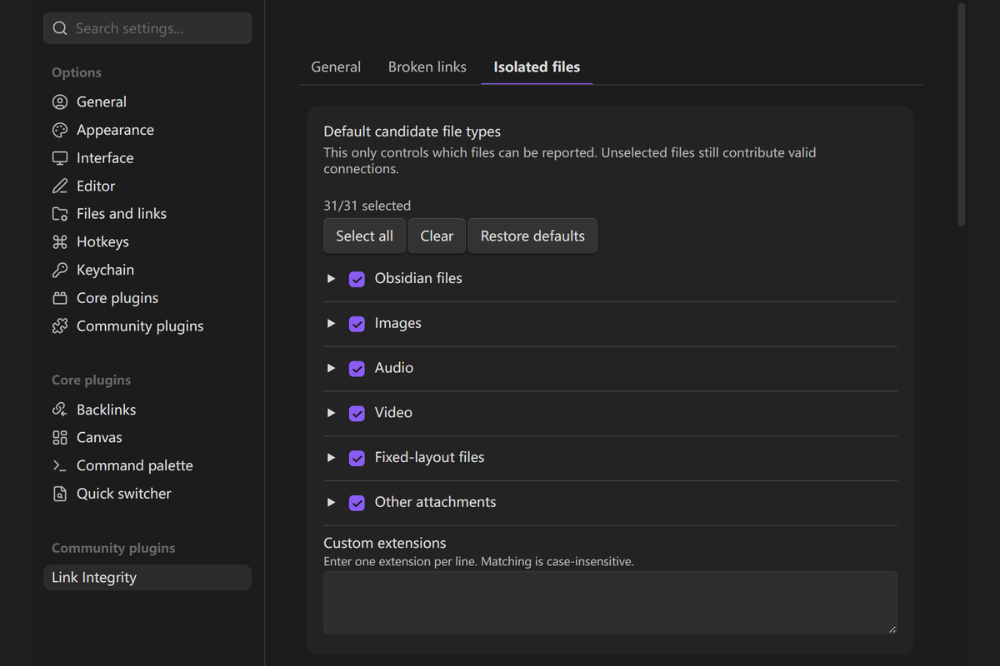

# Link Integrity

[English](../../README.md) · [简体中文](README.zh-CN.md) · [繁體中文](README.zh-TW.md) · [日本語](README.ja.md) · [한국어](README.ko.md) · [Deutsch](README.de.md) · [Français](README.fr.md) · [Español](README.es.md) · [Português (Brasil)](README.pt-BR.md) · [Русский](README.ru.md) · [Tiếng Việt](README.vi.md) · [العربية](README.ar.md)

يساعدك Link Integrity على العثور على الروابط المعطّلة والملفات التي لا ترتبط بملفات أخرى في خزنة Obsidian. يعرض المشكلات لتراجعها بنفسك، **ولا يغيّر الملاحظات ولا يحذف الملفات**.

تظهر نتيجتان في الشريط الجانبي: **الروابط المعطّلة** و**الملفات المنعزلة**.

## لقطات الشاشة

يمكنك مشاهدة الروابط التي لا تعمل والملفات المنعزلة في شريط جانبي واحد:





وفي الإعدادات يمكنك تحديد أنواع الملفات التي تظهر، وإنشاء قواعد للتجاهل وللملفات التي يُتوقع أن تكون منعزلة:



## الميزات

- يعثر على روابط داخلية تشير إلى ملفات أو عناوين أو كتل غير موجودة في Markdown والتضمينات وخصائص الملفات وCanvas والمراجع المباشرة في Bases.
- يعرض الملفات التي لا تملك رابطًا صالحًا صادرًا إلى ملف موجود ولا رابطًا واردًا من ملف آخر. لا تُحسب روابط الملف إلى نفسه أو الروابط الخارجية.
- يبيّن إذا كان الملف المنعزل يحتوي أيضًا على روابط معطّلة؛ **هذا ليس اقتراحًا بحذفه**.
- يسمح بتمييز القوالب والأرشيفات والملاحظات الدورية التي من الطبيعي أن تبقى بلا روابط على أنها «منعزلة كما هو متوقع».
- يتيح تصفية النتائج حسب Markdown والصور والصوت والفيديو وPDF والمرفقات الأخرى.
- يُحدّث الفحص عند تغيّر الملفات بعد إنشائه أول مرة. ويمكنك فتح الملف المصدر من النتيجة.
- يمكنك تشغيل خطوط متموجة تحت الروابط المعطّلة المؤكدة داخل الملاحظات. هذا الخيار معطّل افتراضيًا.

لا تُحسب نتائج الاستعلامات الديناميكية في Bases روابط مباشرة. إذا كان الملف الهدف موجودًا ولكن عنوانًا أو كتلة بداخله مفقودًا، تبقى العلاقة بين الملفين صالحة ويظهر خطأ العنوان أو الكتلة منفصلًا.

## المتطلبات والتوافق

- Obsidian الإصدار 1.12.7 أو أحدث.
- يعمل على سطح المكتب والأجهزة المحمولة.
- يفحص الخزنة الحالية فقط. لا يطلب صفحات من الإنترنت ولا يتحقق من المواقع الخارجية.

## التثبيت

افتح **إعدادات Obsidian ← الإضافات المجتمعية ← استعراض** وابحث عن Link Integrity. إذا لم تجده، فحمّل `link-integrity-<version>.zip` من [أحدث إصدار على GitHub](https://github.com/ZHYX91/obsidian-link-integrity/releases/latest).

للتثبيت اليدوي، ضع الملفات `main.js` و`manifest.json` و`styles.css` داخل `Vault/.obsidian/plugins/link-integrity/`، ثم أعد تحميل Obsidian وفعّل الإضافة. عند التحديث استبدل الملفات الثلاثة فقط. احتفظ بملف `data.json` لأنه يحتوي على إعداداتك وقواعدك.

## الاستخدام

1. فعّل Link Integrity من الإضافات المجتمعية.
2. افتح الشريط الجانبي من زر الإضافة أو لوحة أوامر Obsidian.
3. افتح **الروابط المعطّلة** لمراجعة الروابط المعطّلة، أو **الملفات المنعزلة** لمراجعة الملفات التي لا تربطها علاقات صالحة بملفات أخرى.
4. اضغط على النتيجة لفتح الملف المصدر. يمكنك تصفية الملفات المنعزلة دون تغيير الإعدادات الافتراضية.

الفحص عند بدء التشغيل معطّل افتراضيًا. يؤدي فتح الشريط الجانبي إلى إنشاء الفهرس عند الحاجة، وبعد ذلك تُحدّث النتائج تلقائيًا مع تغييرات الخزنة. يمكنك إعادة الفحص الكامل من الإعدادات إذا لزم الأمر.

لرؤية المشكلة داخل نص الملاحظة، فعّل عرض الروابط المعطّلة في النص. لن يمنعك ذلك من النقر على الروابط. قد لا تظهر علامة داخل النص عندما لم يُحفظ التعديل بعد أو عندما يتعذر تحديد موضع الرابط بدقة؛ راجع الشريط الجانبي في هذه الحالة.

## الإعدادات

**متى يُعد الملف منعزلًا؟** عندما لا يربطه أي رابط صالح بملف آخر موجود في الخزنة، سواء كان الرابط واردًا أو صادرًا:

- **منعزل:** لا يشير `A.md` إلى أي ملف آخر موجود، ولا يشير أي ملف آخر إليه.
- **لا توجد روابط واردة ولكنه ليس منعزلًا:** إذا احتوى `A.md` على `[[B]]` وكان `B.md` موجودًا، فهما مرتبطان حتى لو لم يشر أحد إلى `A.md`. المرشح المتقدم للملفات بلا روابط واردة يعرض هذه الحالة منفصلة.
- **منعزل مع رابط معطّل:** إذا احتوى `A.md` على `[[Missing]]` ولم يوجد الهدف، فقد يظهر الملف منعزلًا أيضًا. افحصه قبل اتخاذ أي قرار.
- **منعزل كما هو متوقع:** قالب أو أرشيف لا يحتاج إلى روابط. يبقى في الخزنة دون تعديل، ويُعرض منفصلًا عن العدد الأساسي.

تتحكم صفحة **عام** في اللغة والفحص عند التشغيل والصفحة الافتراضية. اختر «اتباع Obsidian» أو العربية يدويًا؛ تُعرض واجهة الإضافة من اليمين إلى اليسار في اللغة العربية.

في **الروابط المعطّلة** تختار أنواع الأخطاء والقواعد التي تتجاهل نتائج معينة. وفي **الملفات المنعزلة** يمكنك تحديد أنواع الملفات، وإضافة قواعد للمجلدات والتواريخ والأسماء. تساعدك إعدادات الملاحظات الدورية على تصنيف اليوميات والأسبوعيات والشهريات وغيرها دون قراءة إعدادات Chrono Notes.

لا تُغيّر قواعد «منعزل كما هو متوقع» الروابط الحقيقية؛ إنها تغيّر طريقة عرض الملفات المنعزلة فقط. بعض قواعد تجاهل الروابط المتقدمة قد تؤثر في حساب الاتصال، لذا راجع المعاينة قبل تطبيقها.

## القيود

- لا تُصلح الإضافة الروابط تلقائيًا ولا تحذف الملفات.
- لا تفحص الروابط الخارجية أو نتائج استعلام Bases الديناميكية؛ تُفحص المراجع المباشرة إلى الملفات فقط.
- لا يُعرض تمييز داخل النص إذا كان تحديد موضع الرابط غير مؤكد.
- لا يعني عدم وجود روابط واردة وحده أن الملف منعزل.
- قواعد الانعزال المتوقع لا تخفي الأخطاء في الروابط.

## الخصوصية والأمان

تجري عمليات الفحص محليًا داخل Obsidian. لا تتطلب الإضافة حسابًا، ولا ترفع محتوى الخزنة إلى خدمة أخرى، ولا تعدّل الملاحظات. تُحفظ الإعدادات وقواعدك في `data.json`، بينما تُحفظ نتائج الفحص في الذاكرة وتُعاد عند الحاجة بعد إعادة التشغيل.

## التطوير

استخدم Node.js 24.19.0 وnpm 11.17.0 ثم شغّل:

```bash
npm ci
npm run check
```

تتوفر الوثائق التقنية في [متطلبات المنتج](../product-requirements.en.md) و[مواصفات الواجهة](../ux-spec.en.md) و[الهندسة](../architecture.en.md) و[خطة الاختبارات](../testing-strategy.en.md). كما يمكنك مراجعة [دليل المساهمة](../../CONTRIBUTING.md) و[سجل التغييرات](../../CHANGELOG.md) و[سياسة الأمان](../../SECURITY.md).

## الدعم

للأسئلة والمقترحات، استخدم [مناقشات GitHub](https://github.com/ZHYX91/obsidian-link-integrity/discussions). وللبلاغات القابلة للتكرار استخدم [صفحة المشكلات](https://github.com/ZHYX91/obsidian-link-integrity/issues/new/choose). لا تنشر مسارات خزنتك الخاصة أو نصوص الملاحظات أو البيانات الشخصية ضمن البلاغات.

## الترخيص

[MIT](../../LICENSE) © ZhengYX
